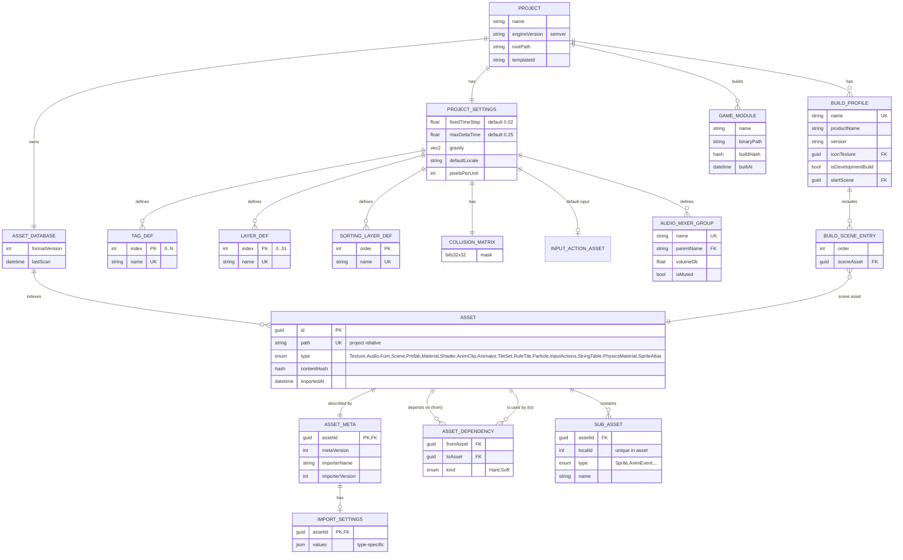
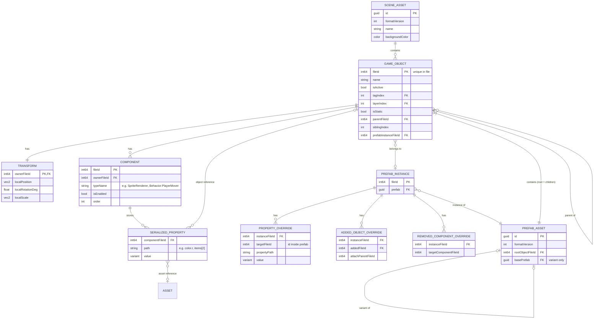
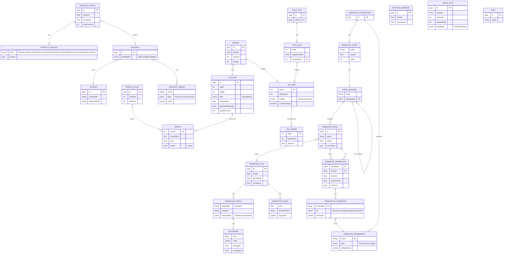
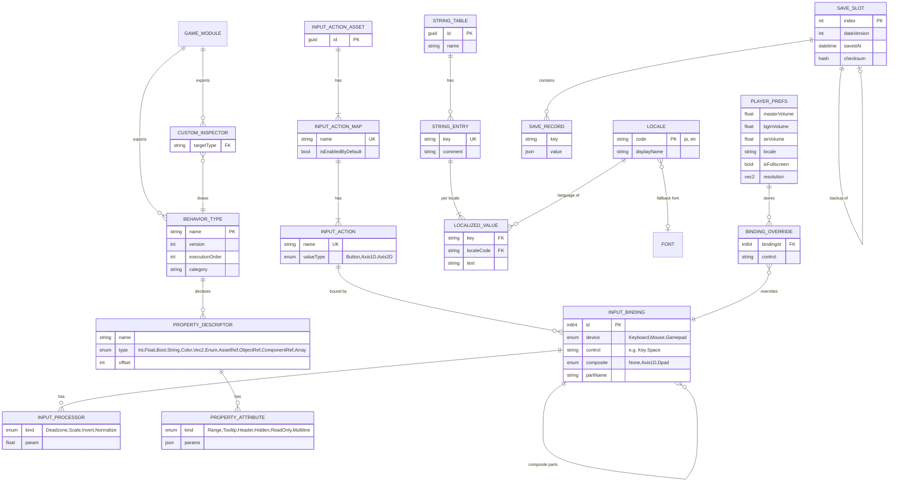
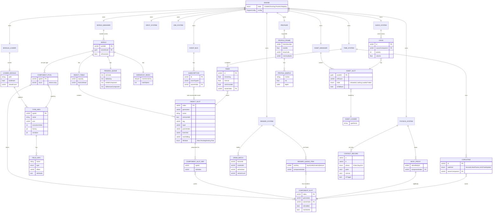

# ER 図: Sprout Engine

本書はデータ構造の正（FR-907）。構造を変える変更は、同じ変更内で本書を更新すること。
GitHub 上では Mermaid として図で表示される。

- **図 1 ドメイン（永続化データ）**: ファイルに保存されるもの。アセット・シーン・Prefab・設定
- **図 2 ランタイム内部**: 実行中のメモリ上の構造。`sprout::detail` 側。利用者からは見えない
- **図 3 エディタ**: エディタ固有の状態
- **付録**: 識別子の規則、カーディナリティの補足

記法: `||--o{` = 1 対 0..N、`||--|{` = 1 対 1..N、`||--||` = 1 対 1、`|o--o|` = 0..1 対 0..1。PK/FK/UK は主キー/外部キー/一意キー。

---

## 図 1. ドメイン（永続化データ）

### 1-A. プロジェクト・アセット基盤

### 1-B. シーン・オブジェクト・Prefab

### 1-C. コンポーネント型（COMPONENT のサブタイプ）

```mermaid
erDiagram
    COMPONENT ||--o| SPRITE_RENDERER : "is a"
    COMPONENT ||--o| TEXT_RENDERER : "is a"
    COMPONENT ||--o| SHAPE_RENDERER : "is a"
    COMPONENT ||--o| CAMERA : "is a"
    COMPONENT ||--o| LIGHT_2D : "is a"
    COMPONENT ||--o| RIGIDBODY_2D : "is a"
    COMPONENT ||--o| COLLIDER_2D : "is a"
    COMPONENT ||--o| JOINT_2D : "is a"
    COMPONENT ||--o| ANIMATOR : "is a"
    COMPONENT ||--o| AUDIO_SOURCE : "is a"
    COMPONENT ||--o| AUDIO_LISTENER : "is a"
    COMPONENT ||--o| PARTICLE_SYSTEM : "is a"
    COMPONENT ||--o| TILEMAP : "is a"
    COMPONENT ||--o| UI_ELEMENT : "is a"
    COMPONENT ||--o| BEHAVIOR : "is a"
    SPRITE_RENDERER }o--o| SPRITE : uses
    SPRITE_RENDERER }o--o| MATERIAL : uses
    COLLIDER_2D }o--o| PHYSICS_MATERIAL : uses
    JOINT_2D }o--o| RIGIDBODY_2D : "connected body"
    ANIMATOR }o--|| ANIMATOR_CONTROLLER : uses
    AUDIO_SOURCE }o--o| AUDIO_CLIP : plays
    AUDIO_SOURCE }o--o| AUDIO_MIXER_GROUP : "outputs to"
    TILEMAP }o--|| TILESET : uses
    TILEMAP ||--o{ TILE_LAYER : has
    BEHAVIOR }o--|| BEHAVIOR_TYPE : "instance of"

    SPRITE_RENDERER { guid sprite FK color tint bool flipX bool flipY enum drawMode "Simple,Sliced,Tiled" string sortingLayer int orderInLayer guid material FK }
    TEXT_RENDERER { string text guid font FK int size color color enum alignment bool isRichText float outline }
    SHAPE_RENDERER { enum shape "Line,Rect,Circle,Polygon" vec2list points color fill color stroke float strokeWidth }
    CAMERA { float zoom color background bits32 cullingMask rect viewport guid renderTarget FK int depth }
    LIGHT_2D { enum type "Point,Spot,Global" color color float intensity float radius float angle bool castsShadow }
    RIGIDBODY_2D { enum bodyType "Dynamic,Kinematic,Static" float mass float gravityScale float linearDamping float angularDamping bool fixedRotation bool isBullet bool canSleep }
    COLLIDER_2D { enum shape "Box,Circle,Capsule,Polygon,Edge,Composite" vec2 offset json shapeData bool isTrigger guid material FK }
    JOINT_2D { enum type "Distance,Hinge,Slider,Spring,Fixed,Target" int64 connectedBody FK json params }
    ANIMATOR { guid controller FK float speed enum updateMode "Normal,Unscaled,Physics" }
    AUDIO_SOURCE { guid clip FK float volume float pitch bool isLooping bool playOnStart int priority bool isSpatial float minDistance float maxDistance }
    AUDIO_LISTENER { float volume }
    PARTICLE_SYSTEM { guid effect FK bool playOnStart enum simulationSpace "Local,World" }
    TILEMAP { guid tileset FK vec2 cellSize enum colliderMode "None,PerTile,Composite" }
    TILE_LAYER { string name int order int32array cells "tile id or -1" int columns int rows }
    UI_ELEMENT { enum kind "Canvas,Panel,Image,Text,Button,Toggle,Slider,ProgressBar,InputField,Dropdown,ScrollView,Mask,LayoutGroup" vec4 anchors vec2 pivot vec4 offsets json kindData }
    BEHAVIOR { string typeName FK }
```

### 1-D. 表現系アセット（描画・アニメーション・物理・音・タイル）

### 1-E. 入力・多言語・セーブ・スクリプト型情報

---

## 図 2. ランタイム内部（sprout::detail）

利用者に渡るのは `GameObject` / `Ref<T>` という**ハンドル（index + generation）**だけ。実体は以下のテーブル群に格納される。

### ハンドル規則
- `GameObject{ worldId, index, generation }` / `Ref<TComponent>{ worldId, typeId, index, generation }`
- 参照解決時に `generation` が一致しなければ無効（FR-104）。スロット再利用時に generation を加算
- 永続化時はハンドルではなく `fileId`（図 1）に変換。読み込み時に `fileId → index` の対応表で再構築

---

## 図 3. エディタ（sprout::editor）

```mermaid
erDiagram
    EDITOR_SESSION ||--|| OPENED_PROJECT : edits
    EDITOR_SESSION ||--|| SELECTION : has
    EDITOR_SESSION ||--|| COMMAND_HISTORY : has
    EDITOR_SESSION ||--|| PLAY_MODE_STATE : has
    EDITOR_SESSION ||--|| EDITOR_LAYOUT : uses
    EDITOR_SESSION ||--|| EDITOR_PREFERENCES : uses
    EDITOR_SESSION ||--o{ EDITOR_WINDOW : opens
    EDITOR_SESSION ||--o{ SCENE_DOCUMENT : "open documents"
    SCENE_DOCUMENT }o--|| WORLD : "edit world"
    SCENE_DOCUMENT ||--o| AUTOSAVE_SNAPSHOT : has
    COMMAND_HISTORY ||--o{ EDITOR_COMMAND : "undo/redo stacks"
    EDITOR_COMMAND ||--o{ EDITOR_COMMAND : "composite children"
    SELECTION ||--o{ SELECTED_ITEM : contains
    PLAY_MODE_STATE ||--o| PLAY_SNAPSHOT : "restore point"
    PLAY_MODE_STATE }o--o| WORLD : "play world"
    EDITOR_WINDOW }o--o| CUSTOM_EDITOR_TOOL : "if extension"
    BUILD_JOB }o--|| BUILD_PROFILE : uses
    EDITOR_SESSION ||--o{ BUILD_JOB : runs
    EDITOR_SESSION ||--o{ COMPILE_DIAGNOSTIC : "from module build"

    EDITOR_SESSION { string engineVersion bool isDirty }
    OPENED_PROJECT { string rootPath guid lastScene }
    SELECTION { enum context "Scene,Asset,PrefabMode" int64 activeItem }
    SELECTED_ITEM { enum kind "GameObject,Asset,AnimatorState,Tile" variant id }
    COMMAND_HISTORY { int capacity "default 500" int savePoint }
    EDITOR_COMMAND { string label datetime time int64 mergeKey enum kind "Create,Delete,SetProperty,Reparent,AddComponent,RemoveComponent,PaintTiles,ApplyOverride,Composite" }
    PLAY_MODE_STATE { enum state "Edit,Playing,Paused,Stepping" }
    PLAY_SNAPSHOT { bytes serializedWorlds list keptProperties }
    SCENE_DOCUMENT { guid sceneAsset FK bool isDirty enum mode "Scene,PrefabEdit" }
    AUTOSAVE_SNAPSHOT { string path datetime savedAt }
    EDITOR_LAYOUT { string name string imguiIni }
    EDITOR_PREFERENCES { enum theme "Dark,Light" enum language "ja,en" float fontScale int autosaveSeconds json shortcuts }
    EDITOR_WINDOW { string typeName bool isOpen }
    CUSTOM_EDITOR_TOOL { string menuPath string typeName }
    BUILD_JOB { enum state "Queued,Compiling,Packing,Done,Failed" string outputPath }
    COMPILE_DIAGNOSTIC { enum severity string file int line string message }
```

---

## 付録 A. 識別子の規則
| 識別子 | 範囲 | 永続 | 用途 |
|---|---|---|---|
| `guid` | 全プロジェクトで一意 | ○ | アセット参照 |
| `localId` | アセット内で一意 | ○ | サブアセット（スプライト等） |
| `fileId` | シーン/Prefab ファイル内で一意 | ○ | オブジェクト/コンポーネント参照の保存 |
| `index + generation` | ワールド内・実行中のみ | × | ハンドル（利用者が使う参照） |
| `typeId` | 実行中のみ（モジュール再読込で再採番） | × | 型の識別。保存時は `typeName` |

## 付録 B. 主な整合性制約
- GAME_OBJECT の親子は木構造（循環禁止）。PREFAB_ASSET の入れ子は DAG（循環禁止）
- 1 GAME_OBJECT に TRANSFORM は必ず 1 つ。同一型コンポーネントの重複は型ごとに許可/禁止を TYPE_INFO で定義（Rigidbody / Animator は禁止）
- PROPERTY_OVERRIDE.targetFileId は参照先 PREFAB_ASSET に存在すること（無ければ「孤立上書き」として警告し保持）
- ASSET.path の変更は ASSET.id を変えない
- LAYER_DEF.index は 0–31、COLLISION_MATRIX は対称
